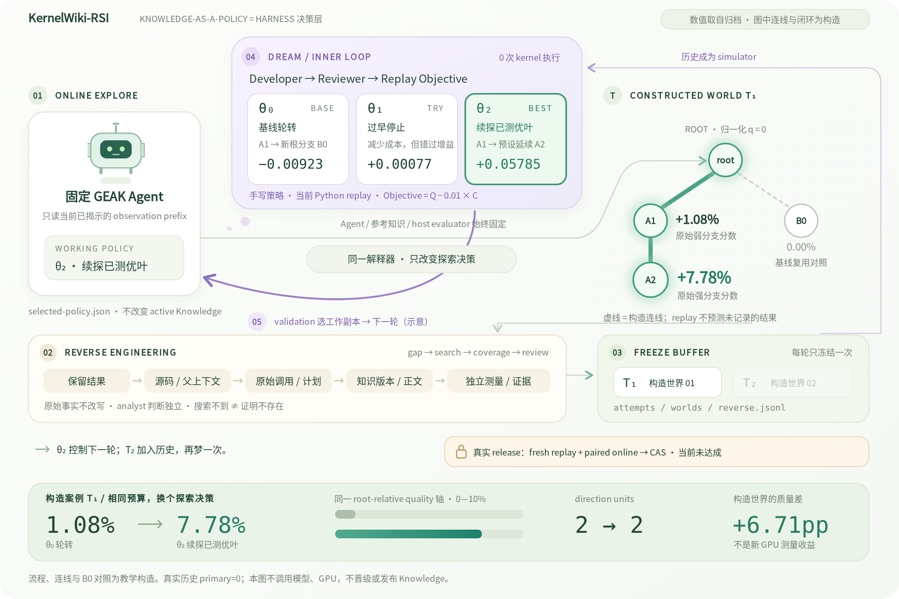
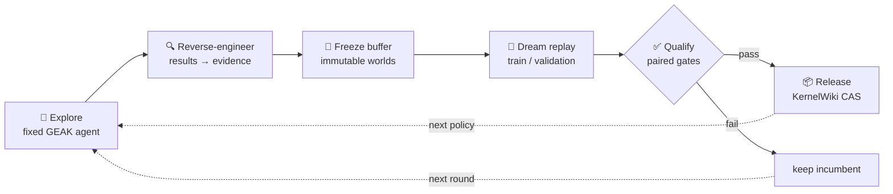
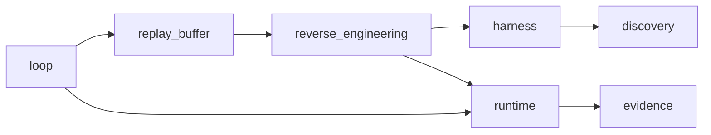

<div align="center">

# KernelWiki-RSI

**Knowledge-as-a-Policy for GEAK kernel optimization**

*Replay past discoveries as dream worlds · evolve the exploration policy · release only what qualifies*


[](https://arxiv.org/html/2609.14858v1)

[How it works](#how-it-works) · [Architecture](#architecture) · [Quick start](#quick-start) · [Results](#results) · [Docs](#further-reading)



<sub>[▶ Play two iterations](docs/visuals/kernelwiki-rsi/index.html) · [SVG](docs/visuals/kernelwiki-rsi/overview.svg) · [Case data](docs/visuals/kernelwiki-rsi/README.md) — mechanisms match the code and numbers come from real archives, but the topology is illustrative.</sub>

</div>

---

KernelWiki-RSI turns GEAK's auditable discovery trees into replayable worlds, evolves a structured
scheduling policy against them, and lets the qualified policy steer the next round of real exploration.
**The generator, model, evaluator and reference knowledge stay fixed. Only the exploration decisions change.**

> [!IMPORTANT]
> The mechanism is implemented and covered by regression tests, but **no self-improvement gain has passed
> the qualification gate yet**. The historical buffer has 0 primary worlds, and diagnostic replay is not promotion evidence.

## How it works



| Stage | Entry point | Guarantee |
| :-- | :-- | :-- |
| **Outer loop** | `loop/outer.py` · `cycle()` | Explicit budget approval before any real run |
| **Inner loop** | `loop/inner.py` · `evolve()` | Selects a working policy only. Never sees test data and never publishes |
| **Release** | `loop/qualification.py` · `release()` | Publishes only after fresh paired replay and online non-regression gates |

## Architecture

```
kernel_workflow/rsi/
├── __main__.py              CLI entry · python3 -m kernel_workflow.rsi
├── harness.py               Policy + Rollout · one state machine for online and replay
├── discovery.py             Attempt · Measurement · DiscoveryNode / DiscoveryWorld
├── evidence.py              EvidenceRef · immutable, line-addressable artifacts
├── runtime.py               RuntimeAgent · fixed agent, bounded processes
├── report.py                Derived coverage and experiment reports
├── glm7_evaluator.py        GLM7 UT bound to the real HIP device
├── agent_workflow.js        One isolated agent call, launched by runtime.py
│
├── loop/                    🔁 discovery, evolution, qualification
├── replay_buffer/           🧊 immutable buffers and finite replay
├── reverse_engineering/     🔍 evidence-bound provenance
└── docs/                    🎞️ visual atlas, roadmap, objective analysis
```

<table>
<tr><th>🔁 <code>loop/</code></th><th>🧊 <code>replay_buffer/</code></th><th>🔍 <code>reverse_engineering/</code></th></tr>
<tr valign="top">
<td>

| Module | Role |
| :-- | :-- |
| `outer` | online → reverse → buffer → evolve |
| `inner` | Developer / Reviewer evolution |
| `online` | `explore` · `calibrate` |
| `evaluator` | fixed host measurements |
| `qualification` | paired gates · `release` |
| `run` | frozen inputs · stage receipts |

</td>
<td>

| Module | Role |
| :-- | :-- |
| `build` | `ingest` · `freeze` |
| `store` | read-only snapshots |
| `cohorts` | primary / diagnostic splits |
| `simulator` | recorded transitions only |
| `objective` | replay objective |
| `evaluate` | paired evaluation |

</td>
<td>

| Module | Role |
| :-- | :-- |
| `model` | Relation · Gap · ReverseReport |
| `trace` | evidence → observations |
| `investigate` | per-gap search, coverage |
| `analyst` | bounded method review |
| `sources/archive` | GEAK audit runs |
| `sources/capture` | harness captures |

</td>
</tr>
</table>



`tests/test_structure.py` enforces this direction: `reverse_engineering` and `runtime` never import `loop`
or `replay_buffer`, and the import graph stays acyclic. Each package owns its own `tests/`, `roles/` and
`configs/`. The KernelWiki SDK is an external dependency and is not vendored.

## Design invariants

| | Invariant | Meaning |
| :-: | :-- | :-- |
| 🧊 | **Replay only reveals** | No agent or GPU calls, and no synthesized branches. A missing transition never buys a cheaper score |
| ⚖️ | **Facts ≠ judgments** | Raw measurements and decisions keep provenance. Reviews can't rewrite them, and partial search proves no absence |
| 🧱 | **Primary support first** | Without train/validation primary support: zero agent calls, incumbent kept |
| 🚦 | **Select ≠ publish** | Inner loop never publishes. Release needs fresh paired replay and online gates |
| 🔒 | **Fixed agent** | `claude-opus-5.5 --effort high`, with no fallback, tools/MCP, session reuse or schema retries |

## Quick start

> **Requirements:** Python ≥ 3.10, PyYAML, and a KernelWiki checkout that provides `KnowledgeClient`.
> Run from the **GEAK repository root**.

```bash
export KERNELWIKI_ROOT=/absolute/path/to/KernelWiki
export PYTHONPATH="$KERNELWIKI_ROOT:$PWD${PYTHONPATH:+:$PYTHONPATH}"
export POOL=/absolute/path/to/pool-schema2
export RSI_OUT="$(mktemp -d /tmp/kernelwiki-rsi.XXXXXX)"
```

**Inspect and replay an existing buffer**

```bash
python3 -m kernel_workflow.rsi report --pool "$POOL" --output "$RSI_OUT/coverage.md"
python3 -m kernel_workflow.rsi replay --pool "$POOL" --wiki "$KERNELWIKI_ROOT" \
  --split train --cohort diagnostic --output "$RSI_OUT/replay.json"
```

**Reverse-investigate one attempt from a raw GEAK run** (no buffer needed)

```bash
python3 -m kernel_workflow.rsi investigate --run "$AUDIT_RUN" \
  --kernel "$KERNEL" --campaign "$CAMPAIGN" --attempt "$ATTEMPT" \
  --max-steps 4 --model-calls 0 --output "$RSI_OUT/reverse"
```

<details>
<summary><b>All commands</b></summary>

| Command | Purpose |
| :-- | :-- |
| `ingest` · `freeze` | Build a new immutable buffer from raw history, online captures or investigations |
| `trace` · `investigate` | Reverse-engineer one attempt. Takes exactly one of `--run`, `--online` or `--pool` |
| `replay` | Evaluate a pinned policy without agent or GPU execution |
| `evolve` | Bounded inner train/validation evolution |
| `report` | Render coverage and qualification reports |
| `explore` · `calibrate` | Online discovery with the fixed agent and evaluator |
| `cycle` · `release` | Full outer round, then gated KernelWiki publication |

Every output is a new immutable artifact and never overwrites existing results. To merge a reverse report
into a buffer, `CAMPAIGN` must match that buffer's original records. Example configs live in
[`replay_buffer/configs/`](replay_buffer/configs/) and [`loop/configs/`](loop/configs/). See
[Commands and authorization](../../docs/kernelwiki-rsi-v1.md#commands-and-authorization) for the approval
and resume flow.

</details>

## Results

| Evidence | Outcome |
| :-- | :-- |
| **Schema-2 historical buffer** | 1,498 attempts · 528 replay-ready · 153 qualified outcomes · 337 diagnostic worlds · **0 primary worlds** · 3 reverse reports |
| **Inner-loop gate** | `insufficient_primary_support`: 0 agent calls, no promotion, no release |
| **Archived schema-1 Opus run** | Held-out objective improved (−0.00841 → −0.00809), but full-budget quality regressed (0.00555 → 0.00541), so the result was `no_change` |

No qualified better KernelWiki policy or new discovery tree has been found yet. Recovering historical
provenance is not a new discovery and doesn't prove that knowledge causes the gain.

## Testing

```bash
export KERNEL_EXTRACT_LOCK_DIR="$(mktemp -d /tmp/rsi-test-locks.XXXXXX)"
python3 -m pytest -q kernel_workflow/rsi
"${GEAK_NODE_BIN:-node}" interface/runtime/engine/selftest.mjs   # runtime regression, requires Node
```

Remote paired CI pins a published KernelWiki SDK commit through `KERNELWIKI_RSI_REF`, a 40-character SHA.
A green test suite doesn't mean experimental qualification or a Knowledge release.

## Further reading

| | Document |
| :-: | :-- |
| 📘 | [Engineering design & refactor evidence](../../docs/kernelwiki-rsi-v1.md) |
| 🧪 | [Archived Opus experiment: candidates, metrics, rejection reasons](../../docs/kernelwiki-rsi-v1-experiment.md) |
| 📐 | [Replay objective analysis](docs/replay-objective-analysis.md) |
| 🗺️ | [Roadmap](docs/KernelWiki-RSI/roadmap.md) |
| 🎞️ | [Loop atlas & animation](docs/visuals/kernelwiki-rsi/README.md) |
