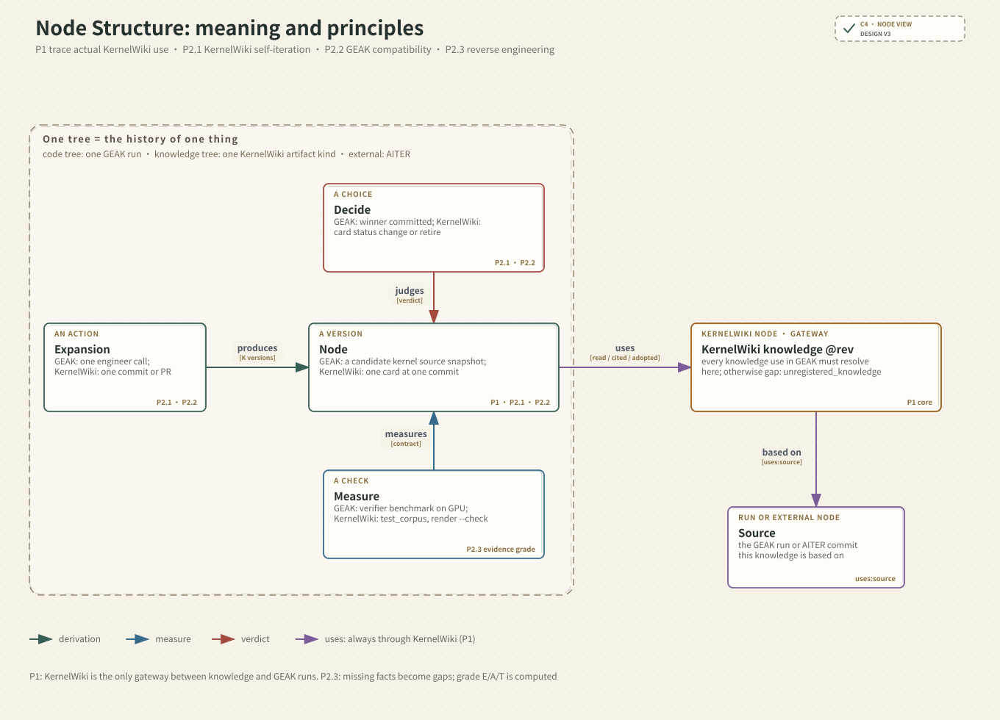
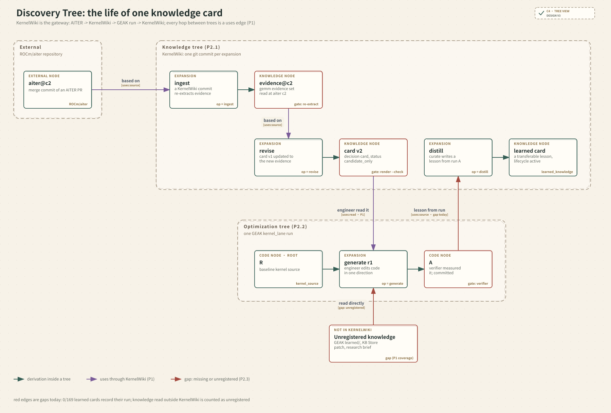

# KernelWiki-RSI v2：Discovery Tree 设计 · 第二版（review + update）

> 已被第三版取代：[`discovery-tree-design-v3.md`](discovery-tree-design-v3.md)。第 1 节的参考系统仍然适用；图已更新为第三版的结构。

> 时间戳：2026-10-29 UTC
>
> 上一版：[`discovery-tree-design.md`](discovery-tree-design.md)。本文是设计，没有改代码。
> 依据：`kernel_lane.js`、`kernel_workflow.js`（bakeoff）、`e2e_workflow.js` 的阶段结构，v1 的 `discovery.py`、`reverse_engineering/model.py`，以及第 1 节列出的公开系统设计。
>
> **实现状态（2026-10-29）：** 阶段 1（`kernel_workflow/rsi/trace/`）和阶段 2（基于树的 replay）已实现。树的边界改为每个 campaign×kernel 一棵；遇到未重建的起点时开新段。结果和修订后的通过条件见 [historical-data-replay-diagnosis.md](historical-data-replay-diagnosis.md) 第 5 节第 2 步。integrate、adopt、emit 尚未从归档重建。

## 0. 这一版改了什么

| # | 第一版的问题 | 这一版的修改 | 借鉴自 |
| --- | --- | --- | --- |
| R1 | 只有单个 lane。e2e 会嵌套 lane，bakeoff 会从同一个冻结 baseline 并行跑 N 个 lane，这两种都表达不了 | 新增 `delegate` 操作和 `tree.parent`，子树挂在父树的某个 expansion slot 上 | OpenLineage ParentRunFacet、OTel 父 span |
| R2 | `Outcome` 把测量、选择、成本混在一起，而且一个节点只能有一次测量 | 拆成 `measure`（可以多次，由不同测量方给出）和 `decide`（commit、incorrect、failed、stop） | MLMD Event、OpenLineage 的增量事件 |
| R3 | 知识只是边上的属性，emit 只在 end 出现，没法跨 run 查询"某条知识被谁用过、效果如何" | 知识成为全局实体 `record@revision`；`uses` 带 role；`emit` 带 `derived_from` | W3C PROV used、wasDerivedFrom |
| R4 | 没有定义身份，replay 时"同一个动作"靠什么 join 是模糊的 | 只用已有的两种身份：源码 `state` 指纹和知识 `revision`。replay 以 expansion 为 join 单位，它的子节点就是这个动作的样本。**不新增 digest** | Git（commit 和 tree 分开）；Bazel REAPI 用作对照 |
| R5 | `ContextRef.derived_from` 把"代码从哪来"和"信息从哪来"混在一起 | `parents` 只表示代码派生；改名为 `informed_by`，只表示信息流入 | OTel：fan-in 用 links，不强行指定单一父节点；AlphaEvolve 的 inspirations |
| R6 | 没有扩展机制，每接一个使用方，就得往核心 schema 里加字段 | 加命名空间 `facets`。核心不变式和等级计算都不读 facet | OpenLineage facets |

保持不变（文献印证了这些选择）：

- 以"一次展开"作为决策单位（AIDE 的 operator、MLMD 的 Execution）；
- 只追加的日志是唯一事实来源，树是 fold 出来的（event sourcing、OpenHands）；
- 等级由计算得出、不能写入；
- 沿用 EvidenceRef、SourceState、Gap、Coverage。

## 1. 参考系统：借了什么，没借什么

| 系统 | 核心思想 | 借用 | 不借用 |
| --- | --- | --- | --- |
| [W3C PROV-DM](https://www.w3.org/TR/prov-dm/) | 三类对象 Entity、Activity、Agent；关系 used、wasGeneratedBy、wasDerivedFrom；用 bundle 表达"溯源的溯源" | 用作概念映射：代码状态和知识是 Entity，Expansion 是 Activity，generation 是 Agent；Tree 相当于 bundle | 不用 RDF、PROV-N 序列化，也不建完整本体 |
| [ML Metadata (TFX)](https://www.tensorflow.org/tfx/guide/mlmd) | Artifact、Execution、Event（INPUT/OUTPUT）、Context；`put_execution` 原子写入一次执行和它的事件 | 一次 expansion 原子写入它的输入引用；Tree 相当于 Context | 不用数据库，也不建类型注册表 |
| [OpenLineage](https://openlineage.io/docs/spec/object-model/) | Job、Run、Dataset；ParentRunFacet 表达嵌套；[facet](https://openlineage.io/docs/spec/facets/) 带 schema URL；START 和 COMPLETE 增量补充信息 | `tree.parent` 表达嵌套；命名空间 facet；测量和裁决后到时追加 | 不用 HTTP 传输协议 |
| [Bazel REAPI](https://github.com/bazelbuild/remote-apis) | Action 的 digest 就是缓存键；CAS 按内容寻址；按 Action digest 查 ActionResult CAS 存放源码快照；"replay 就是查已记录的结果"这个思路 | 暂不引入 action digest。LLM 生成不是确定性的，一个动作对应一组样本，而树内的 expansion 已经就是这组样本。等收集模式需要跨 run 合并样本时，再引入跨 run 的 key |
| [Git 对象模型](https://git-scm.com/book/en/v2/Git-Internals-Git-Objects) | commit 由 tree 加 parents 构成，merge 有多个父节点，全部按内容寻址 | 区分节点的出现（`node.id`）和代码内容（`state`）；integrate 有多个父节点 | 不用可变 ref |
| [OpenTelemetry](https://opentelemetry.io/docs/specs/otel/overview/) | span 只有单一父节点；fan-in 用 links 表达，避免"挑第一个当父节点、其余的看不见" | `parents`（派生）和 `informed_by`（信息流入）分开 | 不用 span 的时间嵌套语义 |
| [Event Sourcing](https://martinfowler.com/eaaDev/EventSourcing.html) 和 [OpenHands](https://docs.openhands.dev/sdk/arch/events) | 只追加的事件日志是事实来源，状态是 fold 的结果，可以重建、按时间点查询、replay | 用 jsonl 日志；冻结的树只是缓存；每条记录带 `schema_version` | 不用订阅总线 |
| [RLDS](https://github.com/google-research/rlds) | episode 由 step（observation、action、reward、is_first/is_last）组成，面向离线 RL | 作为 RSI replay 的**派生视图** | 不把 episode 格式存进核心 |
| [AIDE](https://arxiv.org/abs/2502.13138) 和 [AlphaEvolve](https://arxiv.org/abs/2506.13131) | AIDE 把解组织成树，操作有 draft、debug、improve；AlphaEvolve 的程序库按 parent 加 inspirations 采样 | 操作集合；inspirations 对应 `informed_by`；树的统计量由计算得出 | MAP-Elites 和 islands 属于策略层，不放进核心 |

## 2. 模型：三种实体 + 一种活动



用 PROV 的术语说：

- **Node**（Entity）：某次出现的源码状态，`state` 指向 CAS 中的快照。
- **Knowledge**（Entity）：KernelWiki 的一条记录 `record@revision`。它是全局的，不属于任何一棵树。
- **Measurement**（Entity）：某个测量方在某个合同下对某个节点的测量。
- **Expansion**（Activity）：从 `parents` 出发、在给定 `context` 下、由 `generation`（Agent）执行，产出一组有序的 slot。

**Tree** 是一个 bundle：一组共享同一个 task 和 contract 的记录，可以通过 `parent` 嵌套。

### 2.1 Wire 记录（只追加的 jsonl，7 种）

```text
tree      {id, task: KernelState, contract, params, parent?: {tree, expansion, slot}, facets}
expansion {id, tree, op, parents[], round, context: ContextRef, generation,
           plan: [Slot], dispatched, uses: [KnowledgeUse], facets}
node      {id, tree, expansion | null, slot, state: sha256, uses: [KnowledgeUse], facets}
measure   {node, contract, by: engineer|verifier|director|e2e_gate, independent: bool,
           per_case, score, evidence}
decide    {tree, node | null, verdict: committed|incorrect|failed|stop, reason, threshold?}
emit      {record, revision, kind: card|kernel_code|rule, derived_from: [node], evidence}
gap       {subject: id, ...现有 Gap 字段}

ContextRef   = {informed_by: [node], evidence: [EvidenceRef]}   # 不做逐组件 hash
KnowledgeUse = {record, revision, role: pointed|read|cited|adopted|skill, evidence}
op           ∈ {generate, integrate, adopt, delegate}      # root 是 expansion 为 null 的 node
```

每种记录都有存在的理由。删掉任意一种，就会丢掉下面对应的一个真实场景：

| 记录 | 删掉它会丢掉的场景 |
| --- | --- |
| `tree` | 分不清 e2e 的 throughput 合同和 lane 的 latency 合同；bakeoff 的 N 个 lane 没有归属 |
| `expansion` | 宽度、deep、integrate 这些策略决策无处存放（这是 RSI 的动作空间） |
| `node` | 没有代码状态，也就没有父子关系 |
| `measure` | verifier、director、e2e gate 对同一个节点的多次测量只能留一次；分不清独立测量和自报 |
| `decide` | commit 轨迹和 stop 原因只能靠猜（`:1699` 处的阈值判断） |
| `emit` | 知识出口断开，KernelWiki 的闭环无法追溯 |
| `gap` | 逆向得到的缺口没有地方承载 |

### 2.2 身份

只用已有的两种身份，不新增 digest，也不新增交叉校验（遵循"不做不必要的 hash 匹配"）：

- `state`：沿用 v1 `SourceState` 的源码指纹。CAS 中存放 source 快照。
- `record@revision`：知识的身份，由 KernelWiki 现有的内容 hash 给出。
- `node.id = <expansion.id>/<slot>`，是普通字符串，表示一次出现。同一个 `state` 可以出现多次，比如 commit 后和候选内容相同。
- replay 的 join 单位是 **expansion**：它的子节点就是同一动作的样本。跨 run 合并样本（类似 Bazel 的 action key）推迟到收集模式真正需要时，那时再按具体场景引入。

### 2.3 层级：适配 GEAK 的三种形状

| GEAK 入口 | 在树里的形状 |
| --- | --- |
| `kernel_lane`（optimize/author） | 一棵树，root 是 baseline。每轮一个 `generate` expansion（规划 K 个，派发 `dispatched` 个）；有 ≥2 个 verified 候选时做 `integrate`；warm-start 是 `adopt`，`uses.role=adopted` 指向 `geak:kernel_code` |
| `kernel_workflow` bakeoff | 父树的 root 是冻结 baseline。一个 `delegate` expansion 有 N 个 slot（每种语言一个），每个 slot 是一棵子 lane 树；Report 阶段对父树 slot 节点的 `measure` 用的是同一个冻结合同 |
| `e2e_workflow` | 父树的合同是 e2e throughput。Milestone 对每个 kernel 做一次 `delegate`，子树是 lane；返回的 overlay 是父树里的一个新节点，由 `e2e_gate` 测量。ConfigSweep 和 TuningSkillset 是父树里的 `generate`（用 facet 区分） |

### 2.4 不变式

1. 引用只能指向更早出现的记录，所以 `parents`、`informed_by`、`derived_from` 构成 DAG。
2. 一个 expansion 的子节点共享 context 和 generation，因为这些字段只存一份。
3. `measure.contract` 必须等于它所在树的 `tree.contract`。跨层比较只能通过 delegate 返回的父树节点重新测量。
4. 每棵树里 `committed` 的节点构成一条从 root 出发的链；每次 commit 满足当时的 `threshold`。
5. `tree.parent` 指向的 expansion 必须是 `op=delegate`，而且 slot 在 `dispatched` 范围内。
6. 要标 observed，必须有 observed 的 EvidenceRef；claim 不能升级。
7. 核心不变式和等级计算**都不读 facet**。facet 只服务于各自的使用方。

### 2.5 保真等级（由计算得出）

- **E**：父节点的 state 是 observed；`informed_by ⊆ ancestors(parents)`；有一条 `independent=true` 的测量，且使用本树合同；context 的 evidence 是 observed。
- **A**：父子关系是 observed，但 `informed_by` 中含有非祖先节点（比如 `:1752` 中兄弟节点写入的 memory），或者只有自报测量。
- **T**：其余情况。

## 3. 以 KernelWiki 为中心的三个视图（都是 fold 出来的，不存储）

| 视图 | 计算方式 | 服务对象 |
| --- | --- | --- |
| **Knowledge ledger** | 对每条 `record@revision`：汇总所有 `uses`（按 role 分组）；在同一个 expansion 里，比较用了它的兄弟节点和没用它的兄弟节点（父节点、context、generation 都相同，只差 uses），得到成对差异；沿 `emit.derived_from` 追溯它是由哪个节点蒸馏出来的、后来又被谁 adopted 或 cited | KernelWiki 自迭代：知识的保留、修订、退役。`:1798` 的 citation join 变成这个视图的一个特例 |
| **Replay episodes** | 每棵树是一个 episode，每个 expansion 是一个 step。observation 包括 incumbent、frontier、预算、可用知识；action 包括选哪个父节点、op、K、模式、选哪些知识；reward 是 Δbest − λ·cost。replay 时揭示该 expansion 已记录样本的前 K 个 | RSI 策略学习和资格判定 |
| **Gap worklist** | 列出所有 T 和 A 级的项及其 `gap`，按能提升的等级排序 | 逆向调查：补上证据后**追加**新的 observed 记录，重新 fold 后等级提升 |

策略只能选择有历史样本支撑的动作。没有被展开过的非 winner 节点，仍然需要第 6 节第 3 点的收集模式。

## 4. Discovery tree 结构



## 5. 相对第一版：删掉和新增

| 删掉或合并 | 原因 |
| --- | --- |
| `Outcome` | 拆成 `measure` 和 `decide`（R2） |
| `End` | `stop` 变成 `decide`，emitted 变成 `emit`（R3） |
| 存储的 `DiscoveryTree` 对象 | 改为日志 fold 出来的缓存（event sourcing） |
| `ContextRef.derived_from` | 改名为 `informed_by`，语义收窄（R5） |

| 新增 | 对应的真实场景 |
| --- | --- |
| `tree.parent` 和 `op=delegate` | e2e 的 Milestone、bakeoff 的语言 lane（R1） |
| `facets` | 已经有 ≥3 个使用方需要各自的额外字段，比如 warm-start 的 match_tier、e2e 的 config、逆向的 relation（R6） |

整体从 4 个概念、5 种记录，变成 4 个概念（3 种实体 + 1 种活动）、7 种记录。没有新增服务、数据库或运行时层。

## 6. 需要你决定

1. **schema 归属**：建议放在 GEAK（`kernel_workflow/rsi/trace/`），KernelWiki 只通过 `record@revision` 被引用。
2. **知识粒度**：第一版只记到 record + 内容 hash；行范围先放在 EvidenceRef 里。
3. **收集模式**：memory 只取祖先、偶尔从第二名继续。这是拿到 E 级 primary 的前提。
4. **新问题：e2e 和 bakeoff 的接入顺序。** 建议先用 lane 验证契约；e2e 和 bakeoff 第一阶段只验证 `delegate` 的结构能装下，暂不埋点。

## 决策记录

- **需求和证据**：做一套通用的 node/tree，以 KernelWiki 知识的使用为中心，兼容 lane、bakeoff、e2e 和逆向。证据包括：v1 的 0 个 primary world；lane 的决策点（`:1628`、`:1672`、`:1699`、`:1752`、`:1798`）；bakeoff 和 e2e 的嵌套结构（两个文件的 `phases` 定义）；以及第 1 节的 9 个参考系统。
- **删除**：`Outcome`、`End`、存储的树对象，以及 `derived_from` 的混合语义。
- **最简机制**：一条只追加的 jsonl（7 种记录）加 CAS；树、ledger、episode 都是 fold 出来的视图。身份只沿用已有的 `state` 指纹和知识 `revision`。初稿中的 `action_key`、`node.id` digest、context 逐组件 hash 都已删除，因为没有当前场景需要它们。
- **实际检查**：读了代码和公开规范。没有运行实验，也没有验证。两张图（Node 结构、discovery tree 结构）用 fireworks-tech-graph 的 Style 9（C4 Review Canvas）生成；源文件是 `assets/*.src.json`，生成器的 `check` 全部通过，并导出了 PNG 做目检。
- **当前关卡**：第 1 步"质疑需求"，即这个形状能否装下真实数据。
- **下一步**：用 1,498 条 attempt 做只读重组，再取一个 e2e 或 bakeoff 的 `EVAL_DIR` 只做结构检查。通过条件：E/A/T 分布；`dispatched>1` 的覆盖率；`uses` 中 observed 的比例；delegate 挂载是否全部合法。
