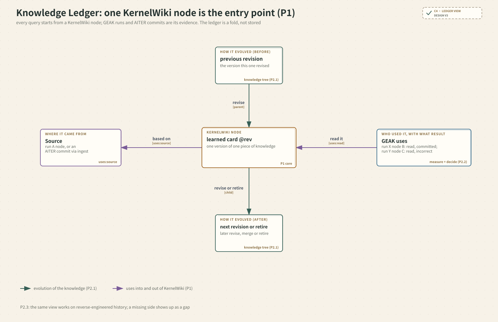

# KernelWiki-RSI：Discovery Tree 设计 · 第三版（知识演化 + 外部入库）

> 时间戳：2026-10-29 UTC
>
> 上一版：[`discovery-tree-design-v2.md`](discovery-tree-design-v2.md)。第二版第 1 节的参考系统（W3C PROV、MLMD、OpenLineage、Bazel REAPI、Git、OpenTelemetry、Event Sourcing、RLDS、AIDE/AlphaEvolve）仍然适用，这里不再重复。
>
> 本文是设计，没有改 GEAK 或 KernelWiki 的代码。第 4 节的数字来自对 KernelWiki git 历史的一次只读投影。

## 0. 这一版改了什么

第二版把"KernelWiki 自迭代"理解成"用 trace 评估知识"，这是错的。正确的需求是：

1. **KernelWiki 内部知识本身的演化**：corpus evidence、决策卡、页面、learned card、kernel bundle 怎样被新增、修订、合并、退役。
2. **外部知识库的入库**，比如 AITER PR。

所以第二版里的知识只是"树外的引用对象"，加一个 `emit`。这只回答了"知识被谁用过"，不回答"知识怎样演化"。这一版**让知识也用同一套 Node/Expansion 结构表示**。

| 修改 | 内容 | 原因 |
| --- | --- | --- |
| 新增 `tree.subject` | 取值为 `kernel_source`、`knowledge:<kind>`、`external` | 同一套记录要表达代码、知识、外部来源三种演化 |
| `node.state` 沿用已有身份 | 代码用源码指纹；corpus 用内容绑定 ID 加 git 版本；bundle 用 `source_digest`；页面和卡片用 git 版本；外部来源用 `repo@commit` | 不新增 digest，也不新增校验 |
| op 按 subject 区分 | 代码：`generate`、`integrate`、`adopt`、`delegate`；知识：`ingest`、`distill`、`author`、`revise`、`merge`、`retire` | 每个 op 都对应 KernelWiki 或 GEAK 里已有的一种改动 |
| `uses` 可以指向任意树的节点 | `KnowledgeUse` 改为通用的 `Use {target, role, evidence}` | 优化节点读知识、知识依据运行或外部来源，是同一种边 |
| **删除 `emit`** | 它就是一次 `distill` expansion | 记录种类从 7 种减到 6 种 |
| `measure` 和 `decide` 对应已有的门和状态 | 见 2.2 节 | 不重复建模 KernelWiki 已有的状态 |
| 知识树是**只读投影** | 知识的内容和状态以 KernelWiki git 为准；trace 只补充"为什么改、依据是什么" | 事实来源只有一份 |


## 1. 设计原则如何落到结构上

| 原则 | 结构上的体现 | 如何检查 |
| --- | --- | --- |
| 以 KernelWiki 为核心，追溯实际使用 | 见 1.1 节：KernelWiki 是知识和 GEAK 运行之间唯一的网关；Knowledge ledger 以 KernelWiki 节点为第一入口；两个方向都必须落到知识的具体版本 | KernelWiki 覆盖率（实际使用中能解析到 KernelWiki 节点的比例）；learned card 的来源覆盖率（目前 0/169） |
| 支持 KernelWiki 自迭代 | 每次知识改动都是知识树中的一个 expansion；质量门和状态对应 measure 和 decide | 第 4 节：用 KernelWiki 的 git 历史投影 |
| 支持外部知识库入库（AITER PR 等） | 外部来源是 `subject=external` 的节点；入库是一次 `ingest`，带 `uses(source)` 指向它 | 第 3 节的流程；第 4 节统计已有页面和 corpus 中固定的 AITER commit |
| 兼容 kernel_workflow 和 e2e_workflow | 优化树的形状与第二版相同（lane、bakeoff 和 e2e 用 `delegate` 嵌套） | 第二版决策记录中的下一步（1,498 条 attempt 的重组）仍待执行 |
| 支持逆向工程 | 知识树本身就是从 git 和 front matter 逆向得到的；缺口记为 `gap`，补到证据后只追加 | 第 4 节就是一次逆向，gap 已分类 |
| 将来的新用途 | 新增 subject 或 op，或者在 facets 中扩展字段；核心记录不变 | 无 |

### 1.1 KernelWiki 为核心：三条约束

如果没有约束，代码树、知识树、外部树的地位是对称的，KernelWiki 只是其中一类树。GEAK 今天读的知识也不只来自 KernelWiki：还有 `perf_knowledge/`、GEAK 仓库里的 `knowledge/learned/`、`expert_skills/`、KB Store 的 warm-start patch，以及 research brief（`kernel_lane.js:159`、`:161`、`:203`、`:1328`、`:1153`）。所以"KernelWiki 为核心"需要靠下面三条约束来保证：

1. **网关**：优化树中每一个知识使用（`uses: read / pointed / cited / adopted / skill`），目标都必须是一个 KernelWiki 知识节点。外部来源只能先经过一次 KernelWiki 的 `ingest`，才能被 GEAK 使用。GEAK 读了不在 KernelWiki 里的知识时，不禁止，而是记为 gap `unregistered_knowledge`。因此 **KernelWiki 覆盖率**是一个可测量的数，它就是 P1 的指标。
2. **主视图**：Knowledge ledger 以一个 KernelWiki 节点为第一入口，回答四个问题：它从哪来、谁用过、效果如何、后来怎样演化。优化树和外部树都是这个知识节点的证据。ledger 由记录 fold 得出，不存储。
3. **具体版本**：使用方向必须指向知识的某个版本（`@rev`），不能只指向"这张卡"；产出方向（`distill`）必须指向产生它的 run 节点。



**读图**：中心是一个 KernelWiki 节点。左边是它的来源（`uses:source`），右边是用过它的 GEAK 节点，以及这些节点的测量和裁决结果，上下两边是它在知识树中的前后版本。

## 2. 结构


**读图**：图中的 P1 / P2.1 / P2.2 / P2.3 对应第 1 节的四条原则。每个方框给出它在现实中对应什么：

- **Node** 是某个东西的一个版本。在 GEAK 里，它是一个候选 kernel 的源码快照；在 KernelWiki 里，它是某个 commit 下的一张卡。
- **Expansion** 是产生新版本的一次动作。在 GEAK 里是一次 engineer 调用；在 KernelWiki 里是一个 commit 或 PR。
- **Measure** 是一次检查。在 GEAK 里是 verifier 在 GPU 上测速；在 KernelWiki 里是 test_corpus 或 render --check。
- **Decide** 是一次取舍。在 GEAK 里是 winner 被 commit；在 KernelWiki 里是卡片改状态或退役。
- **uses** 是跨树的引用，并且总是经过 KernelWiki：GEAK 节点使用的是 KernelWiki 知识节点的某个版本；KernelWiki 节点再依据（`uses:source`）某个 run 或 AITER commit。P1（追溯实际使用）就落在这条边上。

### 2.1 记录（只追加的 jsonl，6 种，wire `schema_version: 4`）

实现：`kernel_workflow/rsi/trace/records.py`。

```text
tree      {id, subject, contract, task: KernelState, params, parent?: {tree, expansion, slot}, facets}
expansion {id, tree, op, parents[], plan: Plan | null, uses: [Use], facets}
node      {id, tree, expansion | null, slot, state, uses: [Use], facets}
measure   {node, contract, by, independent, score | null, evidence, per_case}
decide    {tree, node | null, verdict, reason, threshold?}
gap       {subject: id, gap: {id, classification, question, reasons, coverage?}}

Plan = {round, context: {informed_by[], evidence}, generation: {model, effort}, slots[], dispatched}
Use  = {target: node id, role, evidence}
role ∈ {pointed, read, cited, adopted, skill}   # 代码树的记录读 KernelWiki 知识节点
     | {source}                                  # 知识树的记录引用更早的任意节点
```

- **代码类 op 必须带 `plan`，知识类 op 不能带**，这样"知识改动带着规划字段"这种非法组合无法构造。知识类 expansion 只产出一个节点。
- **知识门只记录"跑过"**：`by` 取 `schema_gate`、`reproduce` 或 `gpu_validate`，`score` 为空，通过或不通过由 decide 的 `accepted` 或 `rejected` 表示。卡片的 status 值仍以 KernelWiki 内容为准，不在 trace 里重复记录。
- **退役是一次 decide（`retired`）**，不产生新版本，所以没有单独的 retire op。

### 2.2 三类 subject

| subject | 节点身份（沿用已有） | op | 合同（质量门） | decide 对应 |
| --- | --- | --- | --- | --- |
| `kernel_source` | 源码指纹（v1 `SourceState`） | generate、integrate、adopt、delegate | lane：kernel latency；e2e：throughput | committed、incorrect、failed、stop |
| `knowledge:evidence_set` | 文件内容 SHA-256；来源是 `aiter_commit` | ingest、revise | 干净 checkout 重新抽取、`test_corpus` | accepted、rejected、retired |
| `knowledge:decision_card` | 所在文件的内容 SHA-256，加上 card id | author、revise、merge | `_render_decisions --check` | 同上；`status`、`evidence_level` 留在 KernelWiki 内容里 |
| `knowledge:*_page` | 文件内容 SHA-256（backend、operator、general 分三类） | ingest、author、revise | **目前没有** | 同上 |
| `knowledge:learned_card` | 文件内容 SHA-256 | distill、revise | **目前没有**（只有 `confirms_*` 计数） | 同上；`lifecycle`、`confidence` 留在内容里 |
| `knowledge:bundle` | 文件内容 SHA-256（`metadata.yaml`） | ingest、distill、revise | `validation`（GPU） | 同上；`reference`、`validated`、`best_known` 留在内容里 |
| `external` | `repo@commit` | 没有 expansion；内部历史交给该仓库的 git | 无 | 无 |

KB Store 的远端记录（`attest`、`retract`）不在 git 中，这一版没有投影。以后接入时，`attest` 映射为 measure，`retract` 映射为 decide。

### 2.3 层级：GEAK 的真实形状

与第二版相同：

- `kernel_lane` 是一棵树；
- bakeoff 是一次 `delegate`，每种语言一个 slot；
- e2e 的 Milestone 也是 `delegate`，子树的最终节点回到父树，由 e2e gate 用父树的合同重新测量。

### 2.4 不变式

1. 引用只能指向更早出现的记录（外部节点除外），所以 `parents`、`informed_by` 和 `uses.target` 构成 DAG。
2. 一个 expansion 的子节点共享 context 和 generation（只对代码树有意义）。
3. `measure.contract` 等于它所在树的合同。
4. 每棵代码树里 `committed` 的节点构成一条从 root 出发的链。
5. `tree.parent` 指向的 expansion 必须是 `op=delegate`。
6. 知识的内容和状态以 KernelWiki git 为准；**trace 不写知识状态**，只投影。
7. 外部节点没有 expansion。
8. 要标 observed，必须有 observed 的 EvidenceRef；核心不变式和等级计算都不读 facets。
9. **网关**：优化树中知识使用（read、pointed、cited、adopted、skill）的目标必须是 `subject=knowledge:*` 的节点；否则记为 gap `unregistered_knowledge`，不能直接指向外部节点或运行节点。

### 2.5 保真等级（由计算得出）

| 等级 | 代码树（与第二版相同） | 知识树 |
| --- | --- | --- |
| **E** | 父节点的 state 是 observed，context 只来自祖先，有独立测量 | 每个 `uses(source)` 都能解析到固定版本的节点，并且记录了质量门的结果 |
| **A** | 父子关系是 observed，但 context 混入了兄弟信息，或者只有自报测量 | 依据能解析到固定版本，但质量门的结果没有记录，或者这类知识根本没有质量门 |
| **T** | 其余情况 | 没有机器可读的依据，或者有引用无法解析 |

## 3. Discovery tree：三类树，一种结构


**读图**：这张图沿着一张知识卡的一生走一遍：AITER PR 入库，GEAK 运行读到它，产出被 commit 的 kernel A，再从 A 提炼出新的 learned card。

- 绿色箭头是树内的派生。
- 紫色箭头是跨树的 uses（P1）。
- 红色箭头是 gap（P2.3）。"lesson from run" 是历史数据里缺失的边：第 4 节的投影显示，169 张 learned card 里没有一张记录了自己的 run，所以这条边今天建不起来。"read directly" 是绕过 KernelWiki 的知识使用（GEAK learned/、KB Store、research brief），记为 `unregistered_knowledge`。

闭环是这样的：外部来源进入 KernelWiki；KernelWiki 的知识被 GEAK 运行读到；运行的结果再被提炼回 KernelWiki。每一段都是一条 `uses` 边，起点和终点都是普通节点。

**AITER PR 入库流程**（以 corpus 为例）：

1. PR 合入后得到 commit c2，记为外部节点 `ROCm/aiter@c2`。
2. 对 gemm 证据集做一次 `ingest`：父节点是 `evidence@c1`，依据 `aiter@c2`，产出 `evidence@c2`；用重新抽取和 `test_corpus` 测量，结果写进 decide。
3. 凡是引用了已消失 evidence ID 的卡片，下一步是一次 `revise`，依据新的证据集，用 `--check` 测量。
4. 如果 PR 带来了新 kernel，就 `ingest` 出一个 bundle 节点（`validation: not_run`）。`gpu_validate` 可以 `delegate` 给一次 GEAK lane 运行，通过后裁决为 `validated`。

## 4. 只读投影：KernelWiki 现有 git 历史有多少 gap

**方法**

- 实现：`reverse_engineering/sources/kernelwiki.py`。命令：`python3 -m kernel_workflow.rsi project-kernelwiki --repo <KernelWiki> --output trace.jsonl`。它取代了最初的 spike 脚本，输出的就是 trace 记录，并且能通过 fold 的全部不变式检查。
- 只读取已提交的 git 对象，不 checkout，不写仓库。运行前后 `git status` 的 hash 一致。
- 范围：KernelWiki HEAD `fb5645410904`，共 9 个 commit。跳过了 1 个 merge commit，因为它的内容就是其分支上各个 commit 之和。
- 粒度：每次知识改动就是一个 expansion 加一个节点。决策卡逐张对比 YAML；evidence 以文件为单位；其余以文件为单位。

**结果**：3,183 条记录，fold 全部通过。共 1,262 个知识版本（节点）；其中 352 个因为文件后来被删除而被裁决为 `retired`。剩下 910 个现存版本：**E 级 0 个，A 级 895 个，T 级 15 个**。外部节点 6 个：3 个 AITER commit、3 个 GEAK commit。

| 知识类型 | 现存版本 | A | T | 已退役 | 说明 |
| --- | ---: | ---: | ---: | ---: | --- |
| backend_page | 256 | 256 | 0 | 198 | 都有固定 commit 的来源；没有质量门 |
| operator_page | 132 | 125 | 7 | 142 | 7 个没有任何机器可读来源 |
| general_page | 331 | 323 | 8 | 0 | 8 个没有任何机器可读来源 |
| learned_card | 157 | 157 | 0 | 12 | A 级只是因为卡片里有固定 GEAK commit 的链接（导入出处），**不是 run 来源** |
| decision_card | 30 | 30 | 0 | 0 | 来源是同一 commit 的 evidence 和页面；门可重跑，结果没有记录 |
| evidence_set | 3 | 3 | 0 | 0 | 来源是 `aiter_commit`；门可重跑，结果没有记录 |
| bundle | 1 | 1 | 0 | 0 | `validation: not_run` |

所有 910 个现存版本都没有记录质量门的结果，所以都停在 A 或 T。除此之外记录下来的 gap：

| gap | 数量 | 分类 | 由谁修 |
| --- | ---: | --- | --- |
| no structured run reference（learned card 的所有版本） | 169 | needs_online_control：由 GEAK 的 curate 写入 run 节点 id | GEAK curate |
| front matter is not valid YAML | 123 | resolvable_local | KernelWiki |
| cited page not found at this commit（卡片 `flydsl-host-launch-contract` 在 `d12c163` 引用的 `version_map.md` 当时还不存在） | 1 | resolvable_local（HEAD 上已能解析） | 无 |

**结论**

1. **外部入库这条路已经基本具备**。页面里固定 commit 的链接、corpus 的 `provenance.aiter_commit`（没有 dirty source）都能解析成外部节点。所以 `ingest` 的依据能投影到 A 级。
2. **知识和运行之间的连接（distill）完全断开**。169 个 learned card 版本里没有一个有结构化的 run 引用，所以从知识树到优化树的 `uses(source)` 一条也建不起来。这是"围绕 KernelWiki 追溯实际使用"这个闭环上最大的缺口。修复的位置在**写入方**：GEAK 的 curate 写卡片时，写入 run 节点 id，并且保证 front matter 是合法 YAML。
3. **没有一个改动记录了质量门的结果**，所以 E 级是 0。corpus 的门可以按需重跑，不需要新存储；页面和 learned card 根本没有门，需要先决定要不要有。
4. **历史粒度很粗**。94% 的现存版本来自整批导入的 commit（主要是首个 commit `6dac30c`），每个知识的"为什么"只有那次 commit 的说明。对这些版本，真正的 op 是"从 GEAK 导入"（`ingest`，来源是 GEAK `02bfbb0b`），而不是投影推断出的 `distill` 或 `author`。它们原始的提炼过程在 GEAK 仓库的历史里，不在 KernelWiki 里。

**投影的局限**

- 页面中"固定版本的 GitHub 链接"被当作来源，但链接可能只是引用，不一定是这次改动的依据。指向 KernelWiki 自身的链接不算外部来源。
- 最初的 spike 把 2 张完全没有 front matter 的卡也算成"不是合法 YAML"（125 个），正式 adapter 只统计真正解析失败的（123 个）。
- KB Store 的远端记录没有覆盖。

## 5. 相对第二版：删掉和新增

| 删掉 | 原因 |
| --- | --- |
| `emit` 记录 | 改为 `distill` expansion |
| `KnowledgeUse` 专用类型 | 改为通用的 `Use` |
| "知识是树外的特殊对象" | 知识有自己的树 |

| 新增 | 对应的现有机制 |
| --- | --- |
| `tree.subject` | KernelWiki 中每类知识各有身份、门和状态（2.2 节） |
| 知识类 op | git 中的增、改、删，以及 KernelWiki 的 retract 和 status 变化 |
| `subject=external` 节点 | corpus 的 `provenance.aiter_commit`、页面的固定 commit 链接、bundle 的 `provenance` |

## 5.1 实现状态（2026-10-29）

| 计划步骤 | 状态 | 位置 | 验证 |
| --- | --- | --- | --- |
| 1. trace schema v3 增量（subject、Plan 块、`Use`、删除 `Emit`、网关、知识树等级、新 ledger、覆盖率） | 完成 | `trace/records.py`、`trace/tree.py`；replay、report、build、store 已同步 | RSI 全部 129 个测试通过 |
| 2. KernelWiki 投影 adapter | 完成 | `reverse_engineering/sources/kernelwiki.py`；命令 `project-kernelwiki` | 新测试用临时 git 仓库；真实 KernelWiki 3,183 条记录 fold 通过，仓库未被修改 |
| 3. 归档读取解析到 KernelWiki 节点，以及覆盖率基线 | 完成 | `sources/archive_tree.py`；`ingest` 配置项 `kernelwiki` | 见下方基线 |
| 4. 在线埋点；curate 写入 run id | **未做，等待确认** | `kernel_lane.js`、`rsi_boundary.mjs`、GEAK curate | 会改变 GEAK pipeline 的行为和产出，对应第 6 节问题 1 |

**KernelWiki 覆盖率基线**（GLM7 七个 kernel 的 audit 归档，KernelWiki `fb56454`）：**0 / 2,475**。

- 按 role 分：read 1,558，pointed 784，cited 133。
- 2,292 条读取有内容 hash，但和任何 KernelWiki 文件版本的内容都不相同，因为 GEAK 读的是自己的知识副本；183 条没有任何版本（learned_refs）。
- 5 个 campaign 里只有 2 个重建出了代码树（共 24 棵）。另外 3 个产出 0 条 trace 记录，这次没有排查原因。

按网关约束，这个 0 是如实的结果：要让它上升，GEAK 运行就必须读 KernelWiki 的某个版本，或者 KernelWiki 把 GEAK 的知识原样入库。

**旧数据的兼容性**：wire 的 `schema_version` 从 3 升到 4。按项目已有的规则，旧 pool 的 `trace.jsonl` 需要从原始归档重新 `ingest`，不做原地迁移。

## 6. 需要你决定

1. **learned card 的写入约定**（对应第 4 节结论 2）：要不要让 GEAK 的 curate 在 front matter 中写入 `source_run`（运行节点 id），并且保证 front matter 是合法 YAML？这需要同时改 GEAK 和 KernelWiki 的约定。
2. **页面和 learned card 要不要有质量门？** 比如对页面做引用和链接的解析检查。如果不要，这两类知识的上限就是 A 级。
3. **门的结果存在哪里？** 我建议对 corpus 按需在当时的 commit 上重跑，不新增存储。
4. **历史 learned card 要不要跨仓库补齐**：去 GEAK 仓库的历史里找到原始卡片和对应的 run？

## 决策记录

- **需求和证据**：自迭代指 KernelWiki 内部知识的演化，以及外部来源入库。依据是 KernelWiki 的 `knowledge/README.md`、`corpus/README.md`、`kernels/README.md`、`_store/*.py`，以及 learned card 的 front matter。
- **删除**：`emit`、`KnowledgeUse` 专用类型，以及"知识在树外"这个概念。
- **最简机制**：一套记录，用 `tree.subject` 区分三类树；身份只沿用已有的；知识树是从 git 只读投影出来的。
- **实际检查**：对 KernelWiki 历史做了只读投影（9 个 commit，1,614 个 expansion）。修正了评估器的一个解析问题后重新运行，并人工核对了唯一一个无法解析的引用。三张图用 fireworks-tech-graph 的 Style 9 生成，`check` 全部通过，并导出 PNG 做了目检；图上标注了每个元素的物理意义和对应的原则编号。
- **当前关卡**：计划第 1 到 3 步已实现并验证（129 个测试通过，KernelWiki 投影通过 fold，覆盖率基线 0/2,475）。第 4 步（在线埋点和 curate 写入 run id）会改变 GEAK pipeline，等待对第 6 节问题 1 的确认。
- **下一步**：拍板之后，二选一：先做 GEAK 侧的 1,498 条 attempt 重组（第二版留下的下一步），或者先做 learned card 写入约定的最小改动。
