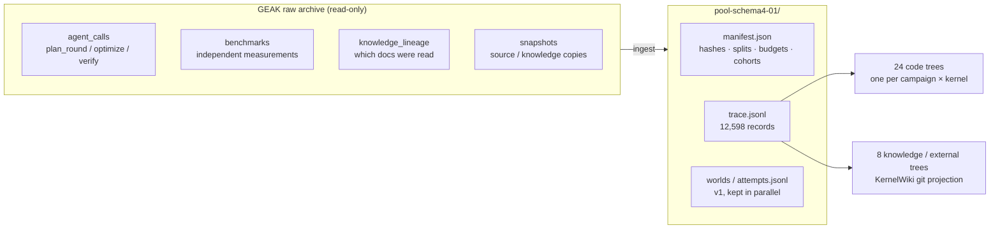
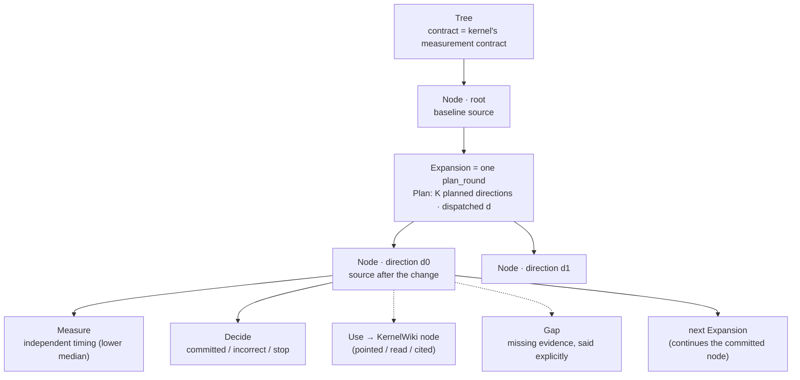
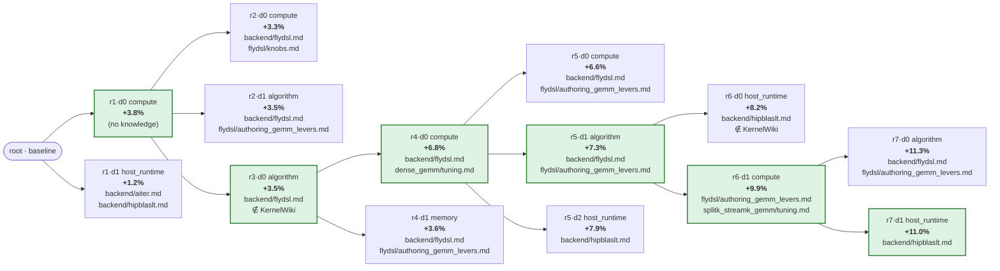
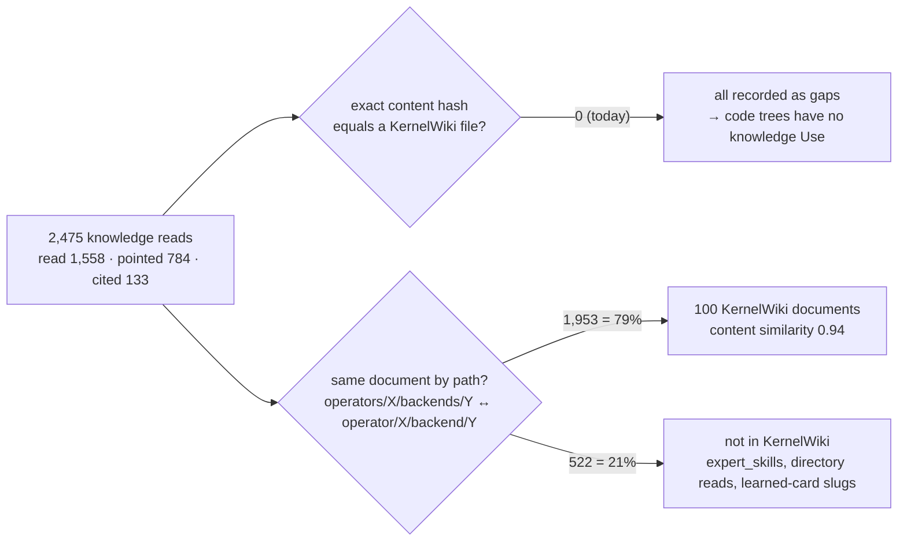
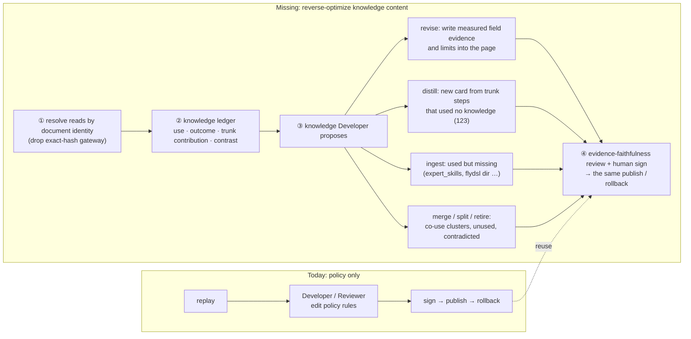

# Replay Buffer Canvas · `pool-schema4-01`

> **Data:** GLM 7 kernels · 2 campaigns (node039, node056-0922) · KernelWiki `fb56454` · as of 2026-11-03
>
> **Path:** `/shared_nfs/zepingl/geak_audit/checks/kernelwiki_rsi_schema3_shape_20261029/pool-schema4-01/`
>
> **Scripts that regenerate the numbers:** `…/kernelwiki_rsi_policy_v2_exp_20261029/scripts/` (`buffer_atlas.py`,
> `tree_mermaid.py`, `knowledge_identity.py`, `knowledge_usefulness.py`)

---

## 1 · Structure: how one optimization run becomes a tree

| Record kind | Count | Meaning |
| :-- | --: | :-- |
| tree | 32 | 24 code trees + 7 knowledge trees + 1 external tree |
| expansion | 1,618 | 356 GEAK plan rounds + 1,262 KernelWiki knowledge changes |
| node | 1,850 | 24 roots + 558 directions + 1,262 knowledge versions + 6 external commits |
| measure | 5,450 | independent measurements (a direction can be measured several times) |
| decide | 818 | committed / incorrect / stop / retired |
| gap | 2,830 | **2,475 of them are "knowledge read outside KernelWiki"** (see § 4) |

---

## 2 · Data: what the 24 code trees contain

| kernel | split | trees | rounds | directions | outcome unknown | primary (fully replayable) |
| :-- | :-- | --: | --: | --: | --: | --: |
| dsa-decode | train | 4 | 54 | 84 | 3 | 0 |
| dsa-prefill | train | 2 | 42 | 74 | 5 | 0 |
| dsa-sparse-mla | train | 5 | 55 | 80 | 3 | 3 |
| mxfp4-moe | validation | 5 | 46 | 80 | 2 | 3 |
| mla-bmm | test | 4 | 56 | 76 | 1 | 2 |
| qkv-a-proj | test | 2 | 45 | 70 | 3 | 1 |
| o-proj | test | 2 | 58 | 94 | 5 | 0 |
| **total** | | **24** | **356** | **558** | **22** | **9** |

- **Directions per round:** 1, 2, 3 or 4 directions in 206, 97, 52 and 1 rounds. This is a greedy lane: it mostly
  continues the round's winner.
- **Which direction history continued from:** 267 rounds continued one of their own directions, from position
  d0 / d1 / d2 in 184 / 58 / 25 of them.
- **Why only 9 trees are primary:** 22 directions have unknown outcomes, and one unknown keeps the whole tree out.
  Their sources are all archived, so about 10 GPU-minutes of re-measurement would fill them in.

---

## 3 · One real tree: `node039/qkv-a-proj` (first 7 rounds)

Green nodes are the trunk history committed. Each node lists the KernelWiki documents its direction read, after
§ 4's path resolution.

What this tree shows:
- **Same parent, several rounds.** Rounds 2 and 3 both start from r1·d0: when no direction beats the incumbent,
  the lane replans from the same parent.
- **The committed direction is not always the best measured one** (r5: d1 +7.3% committed, d2 +7.9%). The lane
  commits on its own verify measurement; the buffer uses the lower median of independent measurements. The gap
  between the two is about 0.5%.
- **The first committed direction used no knowledge.** The flydsl documents then dominate the rest of the trunk.

---

## 4 · Knowledge in the buffer: read heavily, almost unlinked

- **Why 0/2,475 is an artifact:** GEAK reads its own copy, which drifted slightly from KernelWiki. Matching exact
  content hashes misses all of them; matching by document identity resolves 79%.
- **Coverage:** of 708 KernelWiki documents, only **70** were read by any measured direction. These runs only
  touched GLM's 7 kernels, so unused does not mean useless.
- **Where trunk progress came from:** 123 of 267 trunk steps **used no knowledge**. They are candidates for new
  knowledge.

| Document (after path resolution) | Directions using it | Improved >0.5% | Sibling pairs | Mean gain vs siblings without it |
| :-- | --: | --: | --: | --: |
| general/backend/gluon/programming_model.md | 50 | 22% | 12 | **−5.1%** |
| operator/sparse_attention_nsa/tuning.md | 47 | 26% | 23 | −0.4% |
| operator/fused_moe_grouped_gemm/backend/flydsl.md | 44 | 30% | 9 | +1.7% |
| operator/dense_gemm/backend/hipblaslt.md | 20 | 60% | 17 | −0.4% |
| general/backend/flydsl/authoring_gemm_levers.md | 27 | 41% | 16 | +0.5% |
| operator/sparse_attention_nsa/backend/triton.md | 25 | 20% | 15 | +1.2% |
| ∉ expert_skills/index.yaml | 30 | 20% | 21 | +1.8% |
| ∉ languages/flydsl/ (directory) | 19 | 32% | 6 | **+3.8%** |

> **Read the contrasts as associations, not causation.** Which document a direction reads is chosen together with
> what the direction tries, and samples are small. They locate knowledge worth a closer look; they do not decide
> it.

---

## 5 · What KernelWiki-RSI can do today, and what is missing

| | Policy (done) | Knowledge content (missing) |
| :-- | :-- | :-- |
| Object | `policy.yaml` + rule cards | Pages, learned cards, decision cards |
| Signal | replay score | ledger: who used it, what happened, paired contrast, trunk contribution |
| Gate | pooled replay gate | Every claim traces to a measured node; replay cannot score text changes |
| Proof of effect | online pairing | online pairing: same runs with the old vs the new knowledge revision |
| Change record | `knowledge:policy` revise | `knowledge:*` revise / distill / ingest / merge / retire (v3 already defines these ops) |
