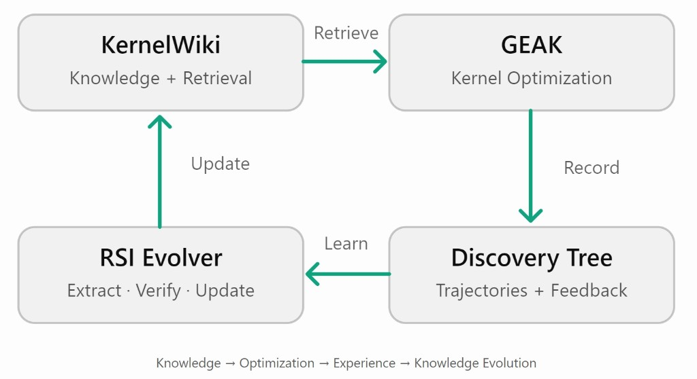

# KernelWiki & KernelWiki-RSI — 4-Week Roadmap

2026.10.20 – 2026.11.20

Overall Goal: Build a reusable GPU kernel optimization knowledge system and integrate it into GEAK, enabling knowledge-driven optimization and preliminary recursive self-improvement (RSI).

W1 · 10/20–10/23

## P0

KernelWiki Architecture & Evaluation Design

设计统一的 Kernel Knowledge Schema、检索接口及演化架构；确定 GEAK baseline、production kernel 测试集与 KB-off/on 评估机制。

交付：KernelWiki 架构设计文档与评估方案。

Milestone · Architecture

ETA 10/23

W2 · 10/24–10/30

## P1

KernelWiki v1: Knowledge Collection & Retrieval

整合现有 `perf_knowledge`、Learned Cards 与 Expert Skills；实现面向 Kernel State（算子、DSL、Shape、Bottleneck）的结构化知识检索。

交付：可查询、可扩展的 KernelWiki v1，支持 Top-K 知识与优化策略推荐。

Milestone · Knowledge Base

ETA 10/30

W3 · 10/31–11/06

## P2

GEAK Integration & Knowledge Feedback Loop

将 KernelWiki 整合进 GEAK kernel optimization workflow；记录优化策略、执行结果与失败原因，构建 Knowledge → Action → Outcome 数据闭环。

交付：Knowledge-augmented GEAK workflow、可追溯的 optimization trajectories，以及初步 KB-off/on 对照结果。

Milestone · Workflow Integration

ETA 11/06

W4 · 11/07–11/20

## P3

KernelWiki-RSI: Self-Evolving Knowledge Loop

基于 production kernel optimization 的 Discovery Trees，自动提炼可复用经验、更新知识适用条件与策略优先级；通过验证与版本管理实现初步知识自进化。

交付：可运行的 RSI loop、KB v0 → v1 演化记录，以及固定预算下的 Knowledge Evolution A/B 评估。

RSI Loop · ETA 11/18

Final Review 11/20

## 核心技术闭环

Knowledge → Optimization → Experience → Knowledge Evolution

## 最终验收标准

1. Knowledge Reusability — KernelWiki 能够针对不同 Kernel States 提供有效的知识检索与策略复用。
2. Optimization Effectiveness — 在固定预算及独立测试集上，验证 KB-on 相比 KB-off 的优化效果与搜索效率。
3. Self-Improvement — 完成至少一次经过验证的知识自动更新，并初步评估更新后对新 kernel 优化任务的收益。

关键边界： 11/20 的目标是验证 Knowledge-level RSI 的最小可用闭环，而不是完整的 GEAK harness 自进化。外部知识自动采集（External Knowledge Harvester）建议放到下一阶段，避免分散当前四周的核心工作。

----
